## Hi! I'm Jin 👋

A Developer from South Korea

  
  
  
  
  

### Languages & Tools

  

  

<!-- BLOG-POSTS:START -->
<h3>📕 Latest Blog Posts</h3>
<ul>
    <li><a href="https://djseo98.tistory.com/15">Docker Compose 1</a></li>
    <li><a href="https://djseo98.tistory.com/14">Docker Volumes</a></li>
    <li><a href="https://djseo98.tistory.com/13">Docker 실습 해보기</a></li>
    <li><a href="https://djseo98.tistory.com/11">docker CLI명령어 정리</a></li>
    <li><a href="https://djseo98.tistory.com/10">docker란?</a></li>
</ul>
<!-- BLOG-POSTS:END -->

  <h3>GitHub Stats</h3>
  <picture>
    <source media="(prefers-color-scheme: dark)" srcset="./profile/stats-dark.svg" />
    <source media="(prefers-color-scheme: light), (prefers-color-scheme: no-preference)" srcset="./profile/stats-light.svg" />
    
  </picture>
  <picture>
    <source media="(prefers-color-scheme: dark)" srcset="./profile/top-langs-dark.svg" />
    <source media="(prefers-color-scheme: light), (prefers-color-scheme: no-preference)" srcset="./profile/top-langs-light.svg" />
    
  </picture>

  <h3>Codex Usage</h3>
  

